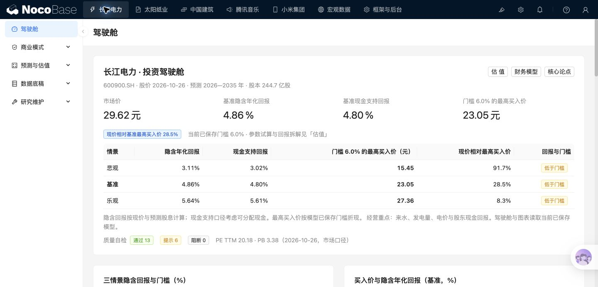
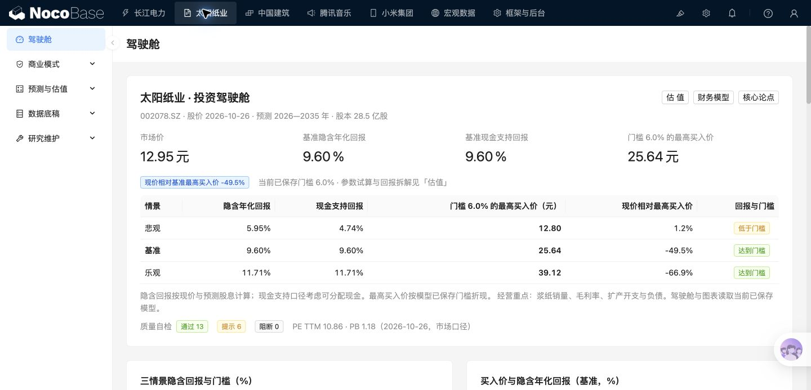
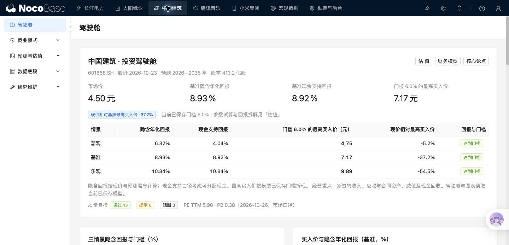
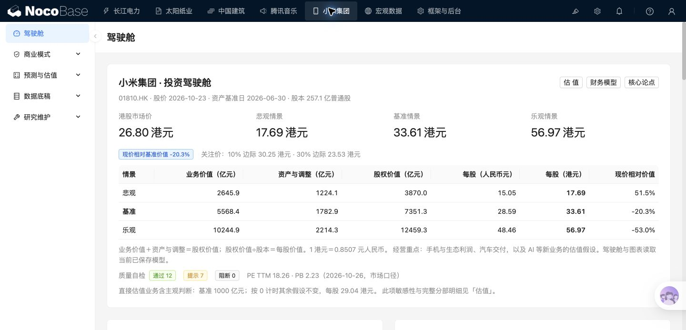

# 驾驶舱改版验收（2026-10-28）

四家公司沿用腾讯音乐的阅读顺序：核心读数与三情景 → 两列核心图 → 底部折叠采集。页面地址保留。

公司记录、模型参数、12 条情景估值、3 条小米分部加总和 76 条质量检查与改前逐字段一致。50 张图的 SQL 均已执行并返回数据，保存的配置与生成器核对一致。逐页截图检查首屏与核心图，采集折叠可展开，未发起采集或保存模型参数。

腾讯音乐的两张股东回报图在本次工作期间由其他工作更新；本次未向腾讯音乐页面发出写操作。

## 长江电力

[打开页面](http://localhost:13000/admin/iihbe468odp) · 12 张图。



| 图表标题 | 资产键 | 线上区块 UID |
|---|---|---|
| 三情景隐含回报与门槛（%） | irr_scen | qpfpl0ude1j |
| 买入价与隐含年化回报（基准，%） | irr_curve | hdj3otk8utg |
| 年度发电量（亿千瓦时） | hist_vol | yai80evr34f |
| 三峡水库水位（米） | level | j44c0znjeva |
| 归母净利润与现金分红（亿元） | hist_np | c06wqs6cplk |
| 经营现金流与资本开支（亿元） | hist_cash | hycsi63epzk |
| 年度毛利率与 ROE（%） | hist_quality | jtvqpq9lnua |
| 带息负债：历史与预测（亿元） | debt | vfj3tv48hhn |
| 基准预测：利润、股息与 FCFE（亿元） | path | e5dpmwgncpl |
| 回报门槛与最高买入价（元） | req_curve | oy7n8hjkr1u |
| A 股收盘价（元/股，不复权） | price | asuztvj6bv0 |
| 价值投资适配度（各项 0—5 分） | fit | gp8it5ihvcn |

## 太阳纸业

[打开页面](http://localhost:13000/admin/d3pps9o6z1p) · 12 张图。



| 图表标题 | 资产键 | 线上区块 UID |
|---|---|---|
| 三情景隐含回报与门槛（%） | irr_scen | k2nhs7s9b03 |
| 买入价与隐含年化回报（基准，%） | irr_curve | ypro3p34o2h |
| 年度浆纸销量（万吨） | hist_vol | mzfv78nwhof |
| 单季毛利率（%） | gm_q | qdek5274inl |
| 归母净利润与现金分红（亿元） | hist_np | wwa2npr3tfe |
| 经营现金流与资本开支（亿元） | hist_cash | phd649e0yty |
| 带息负债：历史与预测（亿元） | debt | fin9muqaji8 |
| 纸浆期货（元/吨，各来源分列） | pulp | 5n5ltb7qkdh |
| 年度毛利率与 ROE（%） | hist_quality | kjy1nf38lvl |
| 基准预测：利润、股息与 FCFE（亿元） | path | siktjmek372 |
| A 股收盘价（元/股，不复权） | price | hjclh50ukd8 |
| 价值投资适配度（各项 0—5 分） | fit | rmc4zuq66td |

## 中国建筑

[打开页面](http://localhost:13000/admin/d9uoj7oiltg) · 12 张图。



| 图表标题 | 资产键 | 线上区块 UID |
|---|---|---|
| 三情景隐含回报与门槛（%） | irr_scen | hta92m25ju0 |
| 买入价与隐含年化回报（基准，%） | irr_curve | vx7e9dxefvk |
| 年度新签合同总额（亿元） | hist_vol | 95yn1bohtrg |
| 收入转化率：收入÷新签合同（%） | conv | 0gqwwfgfheq |
| 营收、应收与合同资产、应付（亿元） | wc | l3qgrn0c48l |
| 年度资产及信用减值损失（亿元） | imp | waq9hqm0rok |
| 归母净利润与现金分红（亿元） | hist_np | iilm6hpynys |
| 经营现金流与资本开支（亿元） | hist_cash | 8yo5ln5fs1t |
| 年度毛利率与 ROE（%） | hist_quality | g7ox11ks0r8 |
| 带息负债：历史与预测（亿元） | debt | pvwpav8u3ab |
| A 股收盘价（元/股，不复权） | price | skt4vsjjv1y |
| 价值投资适配度（各项 0—5 分） | fit | kooojminuug |

## 小米集团

[打开页面](http://localhost:13000/admin/qsjr3v77mh2) · 14 张图。



| 图表标题 | 资产键 | 线上区块 UID |
|---|---|---|
| 基准每股价值桥接（人民币元） | sotp_bridge | j42h0broei3 |
| 成熟业务统一倍数试算（人民币元/股） | sotp_grid | lnjwqh0ysmw |
| 单季分部收入（亿元） | seg_rev | rmb8kxhrxpx |
| 单季分部经营损益（亿元） | seg_profit | e53raluoq1u |
| 单季分业务毛利率（%） | gm_lines | 3c25qq6n8tt |
| 年度分业务经营利润（分摊，亿元） | line_op | t3edjvaq21w |
| 单季智能手机出货（百万台） | ship | zuelh15jevr |
| 单季智能手机 ASP（元） | asp | uvkofvoh952 |
| 单季汽车交付（辆） | ev | kkt7l3e2nzo |
| 全球月活跃用户（百万人，季末） | mau | zku3awmcbbt |
| 经营现金流与资本开支（亿元） | hist_cash | qs3i4eqculh |
| 现金储备与借款（亿元，季末） | cash_q | cp3pgdwwuxl |
| 港股收盘价（港元/普通股，不复权） | price | 5o99xo2rhl2 |
| 价值投资适配度（各项 0—5 分） | fit | g051cpakigi |

## 维护与恢复

生成器：`framework/build_overview.py`、`company_dashboard.py`、`company_dashboard_kpi.jsx`。

原地址更新命令（nocobase 目录）：

```sh
python3 framework/build_overview.py --refresh-dashboard 600900.SH 002078.SZ 601668.SH 01810.HK
```

各公司 `*_rollback_blueprint.json` 的 `data.document` 可通过 `nb api flow-surfaces apply-blueprint` 恢复旧版。改前整库备份：`backups/nocobase_20261028_202029.sql.gz`。