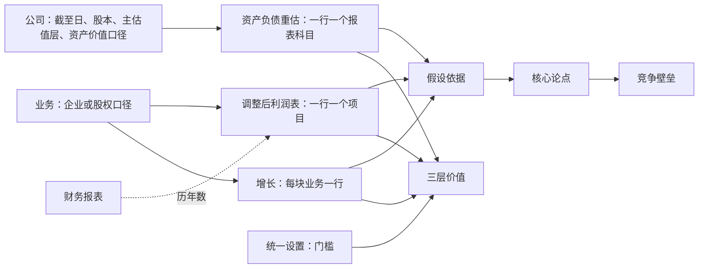
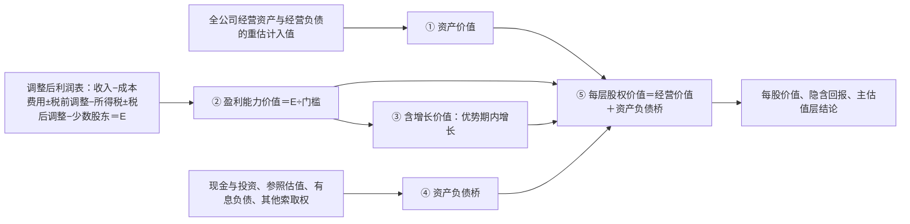
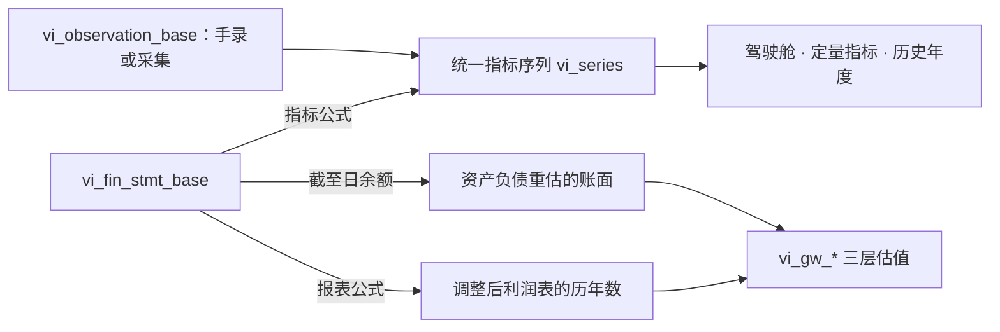

# 数据结构

> 2026-11-20 核验本地库：25 张录入表、24 张关联表、47 个视图、2 个计算缓存。每个字段的含义见《字段字典》。

## 一句话

五家公司共用一套研究库，主线是 **来源 → 事实与数据 → 论点与假设依据 → 三层估值**。公司菜单只是按公司筛选的入口，访问权限由服务端角色控制。

2026-11-11 起估值按「估值地基：Greenwald 三层价值」重构：资产价值 → 盈利能力价值（调整后利润表）→ 增长价值 → 独立资产与调整 → 股权价值；不设情景。旧的估值模型、逐年假设、财务预测、分部加总、统一估值引擎、单参数试验已全部删除，数据搬进新表。

## 四层表

| 层 | 表 | 一句话 |
|---|---|---|
| ① 底稿（事实与数） | 来源文档、事项、定性事实、指标、数据、财务报表 | 只记发生了什么、数是多少；不做判断 |
| ② 研究判断 | 业务分部、商业模式拆解、产业链与五力、竞争对手、竞争壁垒、核心论点、风险分析、价投适配度、假设依据 | 公司凭什么赚钱、哪些判断决定价值、估值参数为什么这样设 |
| ③ 估值输入 | 资产负债重估、调整后利润表、增长（估值设置在公司表，门槛在统一设置；不设情景） | 三层估值要的全部数字，每个数挂假设依据 |
| ④ 维护 | 待办清单、变更日志、统一设置、采集配置、采集运行、原始采集记录 | 研究本身的维护 |

估值结果不存表，全部由视图实时算（`vi_gw_unit`、`vi_gw_value`，检查在 `vi_check` 的 G01—G09）。

## 东西放在哪里

| 要记的 | 放在 | 注意 |
|---|---|---|
| 年报、公告、取数入口 | 来源文档 | |
| 数字以外、会改变判断的事：制度监管、合作授权、并购与资本运作、人事、诉讼、管理层表态、竞争对手动作；卖方预测、可比估值等外部参照 | `vi_event_base`（事项：一件事）→ `vi_fact_base`（这件事的一个侧面，各有日期、来源、核验状态） | 不抄指标里的数；一次性的数字（并购对价、回购额度）可以写 |
| 一个要看的数（收入、付费用户、股价、利率） | `vi_metric_base` | 一条数字序列的定义：单位、来源、公式和指标性质（时期／时点），不存数值 |
| 这个数某一期的值 | `vi_observation_base` | 手录或采集的每期值；报表里有的科目不存，由 `vi_fin_stmt_base` 按公式算 |
| 三大报表原值 | `vi_fin_stmt_base` | 历史年度由它和指标自动汇总；资产负债重估的账面也取它 |
| 对公司的关键判断 | 核心论点 | 正反论证、裁决、改判条件 |
| 估值参数为什么这样设 | 假设依据 | 每个估值输入都必须挂；要持续盯的数在这里关联指标 |
| 一块能单独定价的业务（估值单元） | 业务分部 `vi_business_base` | 以公司披露的经营分部为准；业务的企业／股权口径在这里维护 |
| 资产负债表每个科目怎么归类和重估 | 资产负债重估 `vi_bs_item_base` | 经营资产与经营负债在公司层面汇总为经营资本（第一层）；现金与投资、参照估值、有息负债、其他索取权进入资产负债桥 |
| 不增长时可持续的盈利 | 调整后利润表 `vi_epv_base` | 每块业务一张表、一行一个项目：报表公式给历年数，取值方式给正常化值 |
| 增长 | 增长 `vi_growth_base` | 每块业务一行：增长率、新增投资回报率、优势年限 |
| 截至日、股本、主估值层、资产价值口径、重建成本 | 公司 `vi_company_base` | 一家公司一个估值结论 |
| 投资回报率要求（门槛） | 统一设置 `vi_setting_base` | 只有一行，全部公司共用 |
| 做完即关的事 | 待办清单 | 判断不放这里，放核心论点 |

上层判断有两种依据：“依据事实”引用 `vi_fact_base`，“依据指标”引用 `vi_metric_base`。改来源、事实、论点不会自动改估值；**只有改资产负债重估、调整后利润表、增长、估值设置或门槛，估值才会变**。

## 估值输入怎么连

| 表 | 一行是什么 | 关键字段 |
|---|---|---|
| 资产负债重估 `vi_bs_item_base` | 一个报表科目，或一项报表外研究调整 | 类别、报表科目、折价、调整额、依据 |
| 调整后利润表 `vi_epv_base` | 业务的一个利润表项目 | 段落（收入、成本费用、税前调整、所得税、税后调整、少数股东、不计入）、方向、报表公式、取值方式、数值、起止年份、依据 |
| 增长 `vi_growth_base` | 一块业务 | 增长率、新增投资回报率、优势年限 |

## 估值怎么算

- **一个利率**：门槛（统一设置）。不设情景：三层本身就是从保守到乐观的三种情形，风险体现在选哪一层作结论、价格离它多远，不加在折现率上。
- **口径开关**：企业口径＝利息前利润，有息负债在桥里扣；股权口径＝利息后利润，有息负债归为经营负债（G07 核对口径）。
- **对账**：报表科目行的账面计入值合计＝截至日归母股东权益（G01），每个科目只计一次。
- 公式明细见「框架与后台 / 模型公式」。

| 视图 | 一行 |
|---|---|
| `vi_bs_item_calc` | 资产负债重估每行的账面、重估金额、计入值、用途 |
| `vi_epv_calc` | 调整后利润表每行的历年数（JSON）、正常化值、占收入比例 |
| `vi_gw_unit` | 每块业务：调整后利润表各小计、E、盈利能力价值、含增长价值、增长价值 |
| `vi_gw_value` | 每家公司：账面与调整后经营资本、归母比例、经营资产价值、每层每股价值、主估值层每股价值、隐含回报（不增长／含增长）、结论 |
| `vi_check` | 公司×检查项：C（数据、论点、壁垒、适配度、风险）＋ G01—G09（三层估值） |

## 数字怎么流

同一指标、同一统计时间、同一口径在 `vi_observation_base` 有手录值时，覆盖报表算出的值。

## 时期指标与时点指标

| 指标性质 | 含义 | 例子 | 每期口径 |
|---|---|---|---|
| 时期指标（流量） | 一段时间内累计发生的量；由它们算出的比率也算 | 营业收入、利润、现金流、销量、毛利率、ARPPU | 单季、半年累计、前三季度累计、全年、年初至今累计、滚动四季度 |
| 时点指标（存量） | 某一时刻的状态或规模，不能跨期相加 | 现金、负债、负债率、股价、零售价、用户数 | 只能是“时点” |

- 时期指标的“统计时间”写这段时期（2026Q2＝第二季度，2025＝全年），时点指标写时点所在的报告期（2026Q2＝二季度末）；“对应日期”精确到日。
- 性质与口径对不上时，数据库触发器拒绝保存；指标性质留空的不检查。

## 约定

- 单位：金额为记账币种亿元，股本亿股，每股元。估值里的比率存小数（0.40）；指标按自己的单位存（毛利率指标可能存 40，单位 %），不能照抄。
- 空白＝未知，不是 0：缺参数的业务不输出价值，公司也不输出价值。
- 命名：录入表 `vi_<表>_base`；页面读写视图 `vi_<表>`，写入经触发器回到 `_base`；需要计算的另有 `vi_<表>_calc`；多对多引用存 `vi_lnk_<表>_<字段>`。
- 改公式：先执行 `02_calc.sql`，**紧接着**执行 `03_ui.sql`（02 会连带删掉全部界面视图）。
- 计算缓存 `vi_stmt_cache`、`vi_fin_history_cache` 是物化视图，恢复备份后先刷新前者，再刷新后者。
- 数据库保证唯一性（证券代码、指标代码、业务编号、每块业务一行增长）与归属（业务必须属于同一家公司）。

## 还没做完

- 先只做腾讯音乐（样板）；长江电力、太阳纸业、中国建筑、小米的三层估值已清空，待按 Greenwald 逐家填。
- 小米的商业模式画布按手机、AIoT、互联网三块写，估值里它们是“手机×AIoT 生态”一块业务，画布待合并。
- 定时采集 ①②③ 停用，只用驾驶舱的手动采集；本地和云端不自动同步。

## 表清单

| 分组 | 表 | 行数 | 记什么 |
|---|---|---:|---|
| 总览 | 公司 `vi_company_base` | 5 | 研究的公司：股价取数、业务量口径与估值设置（截至日、股本、主估值层）。 |
| 总览 | 统一设置 `vi_setting_base` | 1 | 全部公司共用的研究参数（只有一行）。 |
| 商业模式 | 业务分部 `vi_business_base` | 10 | 商业模式和估值共用的业务身份：一块能单独定价的业务一行。 |
| 商业模式 | 商业模式拆解 `vi_biz_model_base` | 90 | 用商业模式画布 9 项讲清公司怎么赚钱。 |
| 商业模式 | 产业链与五力 `vi_value_chain_base` | 55 | 产业链上下游各方对公司的议价力强弱。 |
| 商业模式 | 竞争对手 `vi_competitor_base` | 47 | 具体竞争对手的规模、打法和威胁。 |
| 商业模式 | 竞争壁垒 `vi_moat_base` | 41 | 公司有哪些护城河，各靠什么机制成立。 |
| 商业模式 | 核心论点 `vi_thesis_base` | 38 | 决定公司价值的关键判断（问题与结论），每条正反辩论后下结论。 |
| 商业模式 | 风险分析 `vi_risk_base` | 26 | 可能让这笔投资亏钱的事件。 |
| 商业模式 | 价投适配度 `vi_fit_score_base` | 40 | 按八个维度打分，看公司适不适合价值投资。 |
| 数据底稿 | 来源文档 `vi_source_base` | 136 | 所有数据和事实的出处。 |
| 数据底稿 | `vi_event_base` | 63 | 一件事一行（并购、监管变化、竞争格局、资本运作等），短名称加简介；具体的可核验侧面是挂在它下面的定性事实。 |
| 数据底稿 | `vi_fact_base` | 168 | 数字以外、会改变判断的事实：制度监管、合作授权、并购与资本运作、人事、诉讼、管理层表态、竞争对手动作，以及外部观点与估值参照。 |
| 数据底稿 | 财务报表 `vi_fin_stmt_base` | 37745 | 公司的季度三大报表原值。 |
| 数据底稿 | `vi_metric_base` | 213 | 一家公司要看的每一个数（经营、财务、行情与环境），一个指标一行：从哪来、最新值、是否到期。 |
| 数据底稿 | `vi_observation_base` | 6781 | 每个指标每一期的数：统计时间、口径、数值、同比、来源文档和说明。 |
| 估值 | 假设依据 `vi_judgment_base` | 84 | 每个估值参数为什么这样设。 |
| 估值 | 资产负债重估 `vi_bs_item_base` | 34 | 资产负债表逐科目归类与重估（全公司口径）：经营资产与经营负债＝经营资本（第一层），其余＝资产负债桥（独立资产与调整）。 |
| 估值 | 调整后利润表 `vi_epv_base` | 13 | 第二层：每块业务一张调整后利润表，一行一个项目，从报表利润一路算到可持续现金收益 E。 |
| 估值 | 增长 `vi_growth_base` | 1 | 第三层输入：每块业务一行，增长与新增投资回报。 |
| 研究维护 | 待办清单 `vi_issue_base` | 46 | 做完即关的研究与工程待办：数据源、核验、模型缺口、待定的策略选择；不放对公司的判断。 |
| 研究维护 | 变更日志 `vi_change_log_base` | 48 | 每次改假设或数据的记录。 |
| 后台 | 采集配置 `vi_collector_base` | 10 | 自动采集从哪里取数、写进哪个指标。 |
| 后台 | 采集运行 `vi_collect_run_base` | 26 | 每次手动触发采集的记录和结果。 |
| 后台 | 原始采集记录 `vi_raw_capture_base` | 224 | 每次采集拿到的原始响应。 |

另有 24 张多对多关联表 `vi_lnk_<表>_<字段>`，只存两端 id（如“假设依据↔跟踪指标”），各表有哪些写在《字段字典》每节末尾。

待清理：NocoBase 集合目录里还有 1 条失效登记（`vi_lnk_val_input_judgments`），对应的表已删除。

## 哪个页面维护哪张表

公司菜单五家相同（长江电力、太阳纸业、中国建筑、腾讯音乐、小米集团）。“维护的表”指页面上原生表格直接增删改的表。

| 菜单 | 页面 | 维护的表 |
|---|---|---|
| 公司 · 驾驶舱 | 驾驶舱 | 只看（图表、汇总） |
| 公司 · 商业模式 | 商业模式拆解 | 业务分部、商业模式拆解 |
| 公司 · 商业模式 | 产业链与五力 | 产业链与五力、竞争对手 |
| 公司 · 商业模式 | 竞争壁垒 | 竞争壁垒 |
| 公司 · 商业模式 | 风险分析 | 风险分析 |
| 公司 · 商业模式 | 价投适配度 | 价投适配度 |
| 公司 · 商业模式 | 核心论点 | 核心论点 |
| 公司 · 预测与估值 | ① 资产价值 | 公司、业务分部、资产负债重估 |
| 公司 · 预测与估值 | ② 盈利能力 | 业务分部、调整后利润表 |
| 公司 · 预测与估值 | ③ 增长价值 | 增长 |
| 公司 · 预测与估值 | ④ 独立资产 | 资产负债重估 |
| 公司 · 预测与估值 | ⑤ 股权价值 | 公司 |
| 公司 · 预测与估值 | 假设依据 | 假设依据 |
| 公司 · 经营与财务 | 财务报表 | 只看（图表、汇总） |
| 公司 · 经营与财务 | 定量指标 | vi_metric_base |
| 公司 · 经营与财务 | 定性事实 | vi_event_base、vi_fact_base |
| 公司 · 研究维护 | 来源文档 | 来源文档 |
| 公司 · 研究维护 | 质量自检 | 只读：质量自检 |
| 公司 · 研究维护 | 待办清单 | 待办清单 |
| 公司 · 研究维护 | 变更日志 | 变更日志 |
| 宏观数据 | 指标 | vi_metric_base |
| 宏观数据 | 高频数据 | vi_observation_base |
| 宏观数据 | 采集配置 | 采集配置 |
| 框架与后台 | 统一设置 | 统一设置 |
| 框架与后台 | 公司 | 公司 |
| 框架与后台 | 采集 / 采集配置 | 采集配置 |
| 框架与后台 | 采集 / 采集运行 | 采集运行 |
| 框架与后台 | 采集 / 原始采集记录 | 原始采集记录 |
| 框架与后台 | 采集 / 数据（全部指标） | vi_observation_base |
