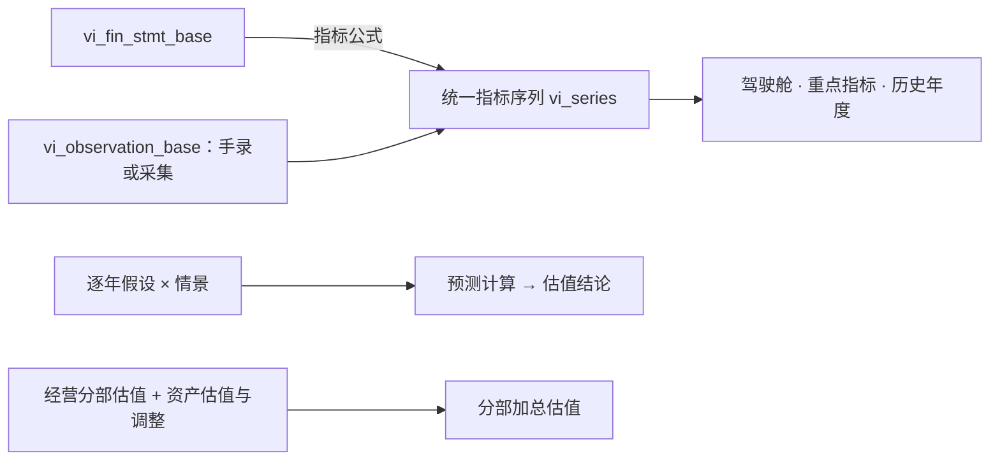

# 数据结构

> 2026-11-04 核验本地库：28 张录入表、29 张关联表、60 个视图、2 个计算缓存。每个字段的含义见《字段字典》。

## 一句话

五家公司共用一套研究库，主线是 **来源 → 事实与数据 → 论点与假设依据 → 逐年假设 → 估值**。公司菜单只是按公司筛选的入口，访问权限由服务端角色控制。

## 东西放在哪里

| 要记的 | 放在 | 注意 |
|---|---|---|
| 年报、公告、取数入口 | 来源文档 | |
| 数字以外、会改变判断的事：制度监管、合作授权、并购与资本运作、人事、诉讼、管理层表态、竞争对手动作；卖方预测、可比估值等外部参照 | `vi_event_base`（事项：一件事，短名称＋简介）→ `vi_fact_base`（这件事的一个侧面，各有日期、来源、核验状态） | 不抄 `vi_metric_base` 里的数；一次性的数字（并购对价、回购额度）可以写 |
| 一个要看的数（收入、付费用户、股价、利率） | `vi_metric_base` | 一条数字序列的定义：单位、来源、公式和指标性质（时期／时点），不存数值 |
| 这个数某一期的值 | `vi_observation_base` | 手录或采集的每期值；报表里有的科目不存，由 `vi_fin_stmt_base` 按公式算。统计时间要连着口径读：2026Q2 可能是单季、累计或季末 |
| 三大报表原值 | `vi_fin_stmt_base` | 历史年度由它和 `vi_metric_base` 自动汇总，不手填 |
| 对公司的关键判断 | 核心论点 | |
| 估值参数为什么这样设 | 假设依据 | 要持续盯哪个数，就在这里或风险里关联指标 |
| 未来逐年经营与现金 | 逐年假设；腾讯音乐用财务预测 | |
| 分部盈利与倍数、现金与投资 | 经营分部估值、资产估值与调整 | 已含在业务价值里的资产不要再加 |
| 做完即关的事 | 待办清单 | 判断不放这里，放核心论点 |

上层判断（商业模式、产业链、壁垒、论点、假设依据、逐年假设、分部与资产估值）有两种依据：“依据事实”引用 `vi_fact_base`，“依据指标”引用 `vi_metric_base`（它的每期值来自 `vi_observation_base` 或报表计算）。

只有改逐年假设、分部或资产估值的输入，估值才会变。改来源、事实、论点不会自动改模型；更新行情和汇率只影响市价对照与币种折算。

## 数字怎么流

同一指标、同一统计时间、同一口径在 `vi_observation_base` 有手录值时，覆盖报表算出的值。

## 时期指标与时点指标

| 指标性质 | 含义 | 例子 | 每期口径 |
|---|---|---|---|
| 时期指标（流量） | 一段时间内累计发生的量；由它们算出的比率也算 | 营业收入、利润、现金流、销量、毛利率、ARPPU | 单季、半年累计、前三季度累计、全年、年初至今累计、滚动四季度 |
| 时点指标（存量） | 某一时刻的状态或规模，不能跨期相加 | 现金、负债、负债率、股价、零售价、用户数 | 只能是“时点” |

- 数据的“统计时间”两类都用：时期指标写这段时期（2026Q2＝第二季度，2025＝全年），时点指标写时点所在的报告期（2026Q2＝二季度末，2026M07＝7 月末）；“对应日期”精确到日。
- 性质与口径对不上时，数据库触发器拒绝保存；指标性质留空的不检查。2026-11-04 起腾讯音乐已全部填写，其他公司暂时留空。
- 数据底稿菜单按表排：财务报表（`vi_fin_stmt_base`）→ 定量指标（`vi_metric_base`，一个指标一行，“趋势”列是主口径最近 12 期的小折线，逐期数据在指标详情里看和录入）→ 定性事实（`vi_fact_base`）→ 来源文档（`vi_source_base`）。

## 两条估值路径

| 路径 | 输入 | 结果 | 谁在用 |
|---|---|---|---|
| 逐年现金流 | 估值模型 + 逐年假设 + 情景 | 预测计算、估值结论 | 长江电力、太阳纸业、中国建筑、小米集团 |
| 分部加总 | 经营分部估值 + 资产估值与调整 | 分部加总估值 | 腾讯音乐；小米集团另有分部估值 |

- 情景：一套基准年度假设乘情景系数展开，不复制三套。分部和资产项的“适用情景”留空＝各情景共用。
- 股权价值＝业务价值＋单独计价的资产与调整净额。
- 腾讯音乐的财务预测只做展示，它的收入和分部估值收入存在两张表，**不会自动同步**，改一边要核对另一边。

## 约定

- 单位：金额为记账币种亿元，股本亿股，每股元。模型里的比率存小数（0.40）；指标按自己的单位存（毛利率指标可能存 40，单位 %），不能照抄。
- 命名：录入表 `vi_<表>_base`；页面读写视图 `vi_<表>`，写入经触发器回到 `_base`；需要计算的另有 `vi_<表>_calc`；多对多引用存 `vi_lnk_<表>_<字段>`。
- 计算缓存 `vi_stmt_cache`、`vi_fin_history_cache` 是物化视图，恢复备份后先刷新前者，再刷新后者。
- 数据库只保证唯一性（证券代码、指标代码、模型＋年度等）。“每个模型只有一个基准情景”这类规则靠维护习惯保证，数据库不约束。

## 还没做完

- 定时采集 ①②③ 停用，只用驾驶舱的手动采集；本地和云端不自动同步。
- 腾讯音乐只读角色已配好，严格的公司数据隔离还要再核验。

## 表清单

| 分组 | 表 | 行数 | 记什么 |
|---|---|---:|---|
| 总览 | 公司 `vi_company_base` | 5 | 研究的公司，以及它的业务量和单价怎么定义。 |
| 商业模式 | 业务分部 `vi_business_base` | 5 | 商业模式和业务估值共用的业务身份；不随模型或情景重复。 |
| 商业模式 | 商业模式拆解 `vi_biz_model_base` | 90 | 用商业模式画布 9 项讲清公司怎么赚钱。 |
| 商业模式 | 产业链与五力 `vi_value_chain_base` | 55 | 产业链上下游各方对公司的议价力强弱。 |
| 商业模式 | 竞争对手 `vi_competitor_base` | 47 | 具体竞争对手的规模、打法和威胁。 |
| 商业模式 | 竞争壁垒 `vi_moat_base` | 41 | 公司有哪些护城河，各靠什么机制成立。 |
| 商业模式 | 核心论点 `vi_thesis_base` | 38 | 决定公司价值的关键判断（问题与结论），每条正反辩论后下结论。 |
| 商业模式 | 风险分析 `vi_risk_base` | 26 | 可能让这笔投资亏钱的事件。 |
| 商业模式 | 价投适配度 `vi_fit_score_base` | 40 | 按八个维度打分，看公司适不适合价值投资。 |
| 数据底稿 | 来源文档 `vi_source_base` | 131 | 所有数据和事实的出处。 |
| 数据底稿 | `vi_event_base` | 12 | 一件事一行（并购、监管变化、竞争格局、资本运作等），短名称加简介；具体的可核验侧面是挂在它下面的定性事实。 |
| 数据底稿 | `vi_fact_base` | 230 | 数字以外、会改变判断的事实：制度监管、合作授权、并购与资本运作、人事、诉讼、管理层表态、竞争对手动作，以及外部观点与估值参照。 |
| 数据底稿 | 财务报表 `vi_fin_stmt_base` | 36512 | 公司的季度三大报表原值。 |
| 数据底稿 | `vi_metric_base` | 177 | 一家公司要看的每一个数（经营、财务、行情与环境），一个指标一行：从哪来、最新值、是否到期。 |
| 数据底稿 | `vi_observation_base` | 3382 | 每个指标每一期的数：统计时间、口径、数值、同比、来源文档和说明。 |
| 估值 | 假设依据 `vi_judgment_base` | 68 | 每个估值参数为什么这样设。 |
| 估值 | 估值模型 `vi_model_base` | 5 | 一家公司一版估值的基本参数。 |
| 估值 | 情景 `vi_scenario_base` | 15 | 各情景对逐年假设的整体调整。 |
| 估值 | 资产估值与调整 `vi_sotp_item_base` | 34 | 现金、投资、固定资产等独立价值，以及负债和归属调整；标明是否已含在业务价值中。 |
| 估值 | 经营分部估值 `vi_sotp_segment_base` | 24 | 分部加总里每个经营业务的估值。 |
| 估值 | 逐年假设 `vi_forecast_base` | 40 | 基准情景下每年的经营与现金假设。 |
| 估值 | 财务预测 `vi_fin_forecast_base` | 3 | 券商研报式的逐年利润表与现金摘要预测（只用分部加总三块的公司，如腾讯音乐）。 |
| 估值 | 单参数试验 `vi_trial_base` | 21 | 只改一个参数，看每股价值变多少。 |
| 研究维护 | 待办清单 `vi_issue_base` | 45 | 做完即关的研究与工程待办：数据源、核验、模型缺口、待定的策略选择；不放对公司的判断。 |
| 研究维护 | 变更日志 `vi_change_log_base` | 41 | 每次改假设或数据的记录。 |
| 后台 | 采集配置 `vi_collector_base` | 9 | 自动采集从哪里取数、写进哪个指标。 |
| 后台 | 采集运行 `vi_collect_run_base` | 18 | 每次手动触发采集的记录和结果。 |
| 后台 | 原始采集记录 `vi_raw_capture_base` | 190 | 每次采集拿到的原始响应。 |

另有 29 张多对多关联表 `vi_lnk_<表>_<字段>`，只存两端 id（如“假设依据↔跟踪指标”），各表有哪些写在《字段字典》每节末尾。

待清理：NocoBase 集合目录里还有 3 条失效登记（`vi_lnk_risk_watches`、`vi_lnk_watch_judgments`、`vi_lnk_watch_theses`），对应的表已删除。

## 哪个页面维护哪张表

公司菜单五家相同（长江电力、太阳纸业、中国建筑、腾讯音乐、小米集团）。“维护的表”指页面上原生表格直接增删改的表。

| 菜单 | 页面 | 维护的表 |
|---|---|---|
| 公司 · 驾驶舱 | 驾驶舱 | 只看（图表、汇总） |
| 公司 · 商业模式 | 商业模式拆解 | 业务分部、商业模式拆解 |
| 公司 · 商业模式 | 产业链与五力 | 产业链与五力、竞争对手 |
| 公司 · 商业模式 | 竞争壁垒 | 竞争壁垒 |
| 公司 · 商业模式 | 风险分析 | 风险分析 |
| 公司 · 商业模式 | 价投适配度 | 价投适配度 |
| 公司 · 商业模式 | 核心论点 | 核心论点 |
| 公司 · 预测与估值 | 重点指标 | vi_metric_base |
| 公司 · 预测与估值 | 财务模型 | 逐年假设、财务预测 |
| 公司 · 预测与估值 | 估值（仅长江电力、太阳纸业、中国建筑、小米集团） | 资产估值与调整、经营分部估值 |
| 公司 · 预测与估值 | 模型底稿 / 假设依据 | 假设依据 |
| 公司 · 预测与估值 | 模型底稿 / 估值模型（仅长江电力、太阳纸业、中国建筑、小米集团） | 估值模型 |
| 公司 · 预测与估值 | 模型底稿 / 情景（仅长江电力、太阳纸业、中国建筑、小米集团） | 情景 |
| 公司 · 预测与估值 | 模型底稿 / 逐年假设（仅长江电力） | 逐年假设 |
| 公司 · 预测与估值 | 估值模型（仅腾讯音乐） | 估值模型、情景、资产估值与调整、经营分部估值 |
| 公司 · 数据底稿 | 财务报表 | 只看（图表、汇总） |
| 公司 · 数据底稿 | 定量指标 | vi_metric_base |
| 公司 · 数据底稿 | 定性事实 | vi_event_base、vi_fact_base |
| 公司 · 数据底稿 | 来源文档 | 来源文档 |
| 公司 · 研究维护 | 质量自检 | 只读：质量自检 |
| 公司 · 研究维护 | 待办清单 | 待办清单 |
| 公司 · 研究维护 | 变更日志 | 变更日志 |
| 宏观数据 | 指标 | vi_metric_base |
| 宏观数据 | 高频数据 | vi_observation_base |
| 宏观数据 | 采集配置 | 采集配置 |
| 框架与后台 | 公司 | 公司 |
| 框架与后台 | 采集 / 采集配置 | 采集配置 |
| 框架与后台 | 采集 / 采集运行 | 采集运行 |
| 框架与后台 | 采集 / 原始采集记录 | 原始采集记录 |
| 框架与后台 | 采集 / 数据（全部指标） | vi_observation_base |
