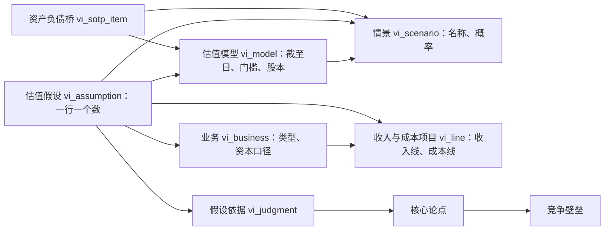
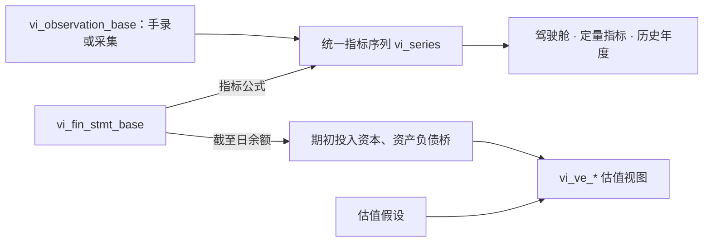

# 数据结构

> 2026-11-09 核验本地库：30 张录入表、29 张关联表、68 个视图、2 个计算缓存。每个字段的含义见《字段字典》。

## 一句话

五家公司共用一套研究库，主线是 **来源 → 事实与数据 → 论点与假设依据 → 估值假设 → 估值**。公司菜单只是按公司筛选的入口，访问权限由服务端角色控制。

2026-11-08 起估值换成**统一估值引擎**：价值＝业务价值合计＋资产负债桥，只用一个门槛利率。旧的估值表（逐年假设、财务预测、经营分部估值、单参数试验）还在，过渡期两套并行，确认后删除。

## 四层表

| 层 | 表 | 一句话 |
|---|---|---|
| ① 底稿（事实与数） | 来源文档、事项、定性事实、指标、数据、财务报表 | 只记发生了什么、数是多少；不做判断 |
| ② 研究判断 | 业务分部、商业模式拆解、产业链与五力、竞争对手、竞争壁垒、核心论点、风险分析、价投适配度、假设依据 | 公司凭什么赚钱、哪些判断决定价值、估值参数为什么这样设 |
| ③ 估值输入 | 估值模型、情景、收入与成本项目、估值假设、资产估值与调整（资产负债桥） | 估值要的全部数字，每个数挂一条假设依据 |
| ④ 维护 | 待办清单、变更日志、采集配置、采集运行、原始采集记录 | 研究本身的维护 |

估值结果不存表，全部由视图实时算（`vi_ve_*`）。

## 东西放在哪里

| 要记的 | 放在 | 注意 |
|---|---|---|
| 年报、公告、取数入口 | 来源文档 | |
| 数字以外、会改变判断的事：制度监管、合作授权、并购与资本运作、人事、诉讼、管理层表态、竞争对手动作；卖方预测、可比估值等外部参照 | `vi_event_base`（事项：一件事）→ `vi_fact_base`（这件事的一个侧面，各有日期、来源、核验状态） | 不抄指标里的数；一次性的数字（并购对价、回购额度）可以写 |
| 一个要看的数（收入、付费用户、股价、利率） | `vi_metric_base` | 一条数字序列的定义：单位、来源、公式和指标性质（时期／时点），不存数值 |
| 这个数某一期的值 | `vi_observation_base` | 手录或采集的每期值；报表里有的科目不存，由 `vi_fin_stmt_base` 按公式算 |
| 三大报表原值 | `vi_fin_stmt_base` | 历史年度由它和指标自动汇总，不手填 |
| 对公司的关键判断 | 核心论点 | 正反论证、裁决、改判条件 |
| 估值参数为什么这样设 | 假设依据 | 每个估值假设都必须挂一条；要持续盯的数在这里关联指标 |
| 一块能单独定价的业务 | 业务分部 `vi_business_base` | **以公司披露的经营分部为准**；共用用户、内容或费用的收入来源不拆成业务 |
| 业务里的收入来源和成本科目 | 收入与成本项目 `vi_line_base` | 收入线、成本线；成本按科目写，不往收入线上分摊 |
| 估值要的每一个数 | 估值假设 `vi_assumption_base` | 一行一个数：业务×（项目）×情景×参数×年份区间 |
| 现金、负债、对外投资、少数股东等 | 资产估值与调整 `vi_sotp_item_base`（资产负债桥） | 已含在业务价值里的只写边界、不计值 |
| 做完即关的事 | 待办清单 | 判断不放这里，放核心论点 |

上层判断有两种依据：“依据事实”引用 `vi_fact_base`，“依据指标”引用 `vi_metric_base`。改来源、事实、论点不会自动改估值；**只有改估值假设、收入与成本项目、资产负债桥、模型或情景，估值才会变**。

## 估值输入：五张表怎么连

| 表 | 一行是什么 | 关键字段 |
|---|---|---|
| 估值模型 `vi_model_base` | 一家公司一版模型 | 基准年、终值年、资产负债日（截至日）、要求收益率（＝门槛，五家 6%）、股本 |
| 情景 `vi_scenario_base` | 悲观、基准、乐观 | 是否基准、情景概率（合计 100%） |
| 业务分部 `vi_business_base` | 一块能单独定价的业务 | 类型（经营｜总部）、资本口径（企业｜股权）；没有收入线时用业务自己的驱动 1—3 |
| 收入与成本项目 `vi_line_base` | 业务里的一条收入线或成本线 | 类型（收入｜成本）、计算方式（驱动｜金额｜收入比例｜单位成本）、基准收入线、驱动名称与单位 |
| 估值假设 `vi_assumption_base` | 一个数 | 业务、项目（留空＝业务层）、情景（留空＝所有情景）、参数、起止年（留空＝整个预测期）、数值、**假设依据（必填）** |
| 资产负债桥 `vi_sotp_item_base` | 一项业务之外的资产或负债 | 类别、计价处理（单独计价｜已含业务估值｜不计价）、取数指标或金额、折价、情景；统一引擎新加的编号以 N 开头 |

估值假设的参数：

| 挂在哪 | 参数 |
|---|---|
| 收入线、成本线 | 驱动1—3、金额、比例、单位成本 |
| 业务（逐年） | 驱动1—3、收入、经营利润率、经营利润（没有成本线时用）、税率、归母比例、资本占用率或净投资 |
| 业务（不分年） | 期初投入资本、正常化经营利润率、永续增长率、终值新增投资回报率、重置成本、直接估值 |

同一个数有情景专属行时，专属行优先；年份区间重叠时取更窄、后录入的一行（自动检查 V07 会报）。

## 估值怎么算

- **一个利率**：门槛（估值模型的要求收益率）。风险体现在情景与概率里，不加在折现率上。每股价值＝门槛下的最高买入价；隐含回报＝按市价买入的年化回报。
- **终值**＝终值年税后利润×(1＋g)×(1−g÷终值新增投资回报率)÷(门槛−g)。新增投资回报率留空＝门槛，即增长不创造价值；高于门槛必须经“成立”的论点连到“真实壁垒”（V03）。
- **三层价值**：资产价值＝重置成本（留空＝期初投入资本）；盈利能力价值＝正常化税后利润÷门槛；全价值＝现金流折现。壁垒价值＝盈利能力价值−资产价值，增长价值＝全价值−盈利能力价值。
- **资本口径**：企业＝经营利润在利息前，负债在资产负债桥里扣；股权＝成本线含利息，资本是归母净资产（中国建筑：负债多、成本远低于门槛）。
- **资本一律是归母口径**：业务的期初投入资本＋资产负债桥的账面项＝报表归母权益（V09 对账）。少数股东要么在资产负债桥里扣，要么用归母比例乘利润，二选一。

| 视图 | 一行 |
|---|---|
| `vi_ve_line` | 情景×项目×年：收入线、成本线的金额 |
| `vi_ve_year` | 情景×业务×年：收入、经营利润、税后利润、投入资本、自由现金流、ROIC |
| `vi_ve_business` | 情景×业务：资产价值、盈利能力价值、全价值、终值占比 |
| `vi_ve_value` | 情景：每股价值、隐含回报、概率加权价值、价格隐含倍率、结论 |
| `vi_ve_check` | 模型×检查项：V01 参数完整 … V09 投入资本对账 |

## 过渡期：旧估值表

| 旧表 | 新框架里由谁代替 | 状态 |
|---|---|---|
| 逐年假设 `vi_forecast_base` | 收入与成本项目＋估值假设 | 旧页面、旧驾驶舱还在读，确认后删 |
| 财务预测 `vi_fin_forecast_base`（腾讯音乐） | 腾讯音乐的收入线与成本线 | 同上 |
| 经营分部估值 `vi_sotp_segment_base` | 业务＋估值假设（直接估值、终值参数） | 同上 |
| 单参数试验 `vi_trial_base` | 只覆盖一行的情景 | 同上 |
| 估值模型上的无风险利率、风险溢价、期初余额、两档安全边际、分部加总参数；情景上的三个系数、折现率、手填倍数 | 门槛；报表取数；情景专属行 | 字段确认后删 |
| 假设依据的“影响参数”“影响年份” | 从估值假设反查 | 字段确认后删 |

旧的分部加总视图 `vi_sotp` 不读 N 开头的资产负债桥项目，两套互不影响。

## 数字怎么流

同一指标、同一统计时间、同一口径在 `vi_observation_base` 有手录值时，覆盖报表算出的值。

## 时期指标与时点指标

| 指标性质 | 含义 | 例子 | 每期口径 |
|---|---|---|---|
| 时期指标（流量） | 一段时间内累计发生的量；由它们算出的比率也算 | 营业收入、利润、现金流、销量、毛利率、ARPPU | 单季、半年累计、前三季度累计、全年、年初至今累计、滚动四季度 |
| 时点指标（存量） | 某一时刻的状态或规模，不能跨期相加 | 现金、负债、负债率、股价、零售价、用户数 | 只能是“时点” |

- 时期指标的“统计时间”写这段时期（2026Q2＝第二季度，2025＝全年），时点指标写时点所在的报告期（2026Q2＝二季度末）；“对应日期”精确到日。
- 性质与口径对不上时，数据库触发器拒绝保存；指标性质留空的不检查。

## 约定

- 单位：金额为记账币种亿元，股本亿股，每股元。模型里的比率存小数（0.40）；指标按自己的单位存（毛利率指标可能存 40，单位 %），不能照抄。
- 空白＝未知，不是 0：缺参数的业务不输出价值，公司也不输出价值。
- 命名：录入表 `vi_<表>_base`；页面读写视图 `vi_<表>`，写入经触发器回到 `_base`；需要计算的另有 `vi_<表>_calc`；多对多引用存 `vi_lnk_<表>_<字段>`。
- 改公式：先执行 `02_calc.sql`，**紧接着**执行 `03_ui.sql`（02 会连带删掉全部界面视图）。
- 计算缓存 `vi_stmt_cache`、`vi_fin_history_cache` 是物化视图，恢复备份后先刷新前者，再刷新后者。
- 数据库只保证唯一性（证券代码、指标代码、业务编号、项目编号等）。“每个模型只有一个基准情景”这类规则靠维护习惯和自动检查保证。

## 还没做完

- 统一估值引擎与旧估值并行；驾驶舱、自动检查 C01—C17 还读旧表。
- 小米的商业模式画布按手机、AIoT、互联网三块写，估值里它们是“手机×AIoT 生态”的三条收入线，画布待合并。
- 定时采集 ①②③ 停用，只用驾驶舱的手动采集；本地和云端不自动同步。

## 表清单

| 分组 | 表 | 行数 | 记什么 |
|---|---|---:|---|
| 总览 | 公司 `vi_company_base` | 5 | 研究的公司，以及它的业务量和单价怎么定义。 |
| 商业模式 | 业务分部 `vi_business_base` | 10 | 商业模式和业务估值共用的业务身份；不随模型或情景重复。 |
| 商业模式 | 商业模式拆解 `vi_biz_model_base` | 90 | 用商业模式画布 9 项讲清公司怎么赚钱。 |
| 商业模式 | 产业链与五力 `vi_value_chain_base` | 55 | 产业链上下游各方对公司的议价力强弱。 |
| 商业模式 | 竞争对手 `vi_competitor_base` | 47 | 具体竞争对手的规模、打法和威胁。 |
| 商业模式 | 竞争壁垒 `vi_moat_base` | 41 | 公司有哪些护城河，各靠什么机制成立。 |
| 商业模式 | 核心论点 `vi_thesis_base` | 38 | 决定公司价值的关键判断（问题与结论），每条正反辩论后下结论。 |
| 商业模式 | 风险分析 `vi_risk_base` | 26 | 可能让这笔投资亏钱的事件。 |
| 商业模式 | 价投适配度 `vi_fit_score_base` | 40 | 按八个维度打分，看公司适不适合价值投资。 |
| 数据底稿 | 来源文档 `vi_source_base` | 135 | 所有数据和事实的出处。 |
| 数据底稿 | `vi_event_base` | 63 | 一件事一行（并购、监管变化、竞争格局、资本运作等），短名称加简介；具体的可核验侧面是挂在它下面的定性事实。 |
| 数据底稿 | `vi_fact_base` | 167 | 数字以外、会改变判断的事实：制度监管、合作授权、并购与资本运作、人事、诉讼、管理层表态、竞争对手动作，以及外部观点与估值参照。 |
| 数据底稿 | 财务报表 `vi_fin_stmt_base` | 36900 | 公司的季度三大报表原值。 |
| 数据底稿 | `vi_metric_base` | 213 | 一家公司要看的每一个数（经营、财务、行情与环境），一个指标一行：从哪来、最新值、是否到期。 |
| 数据底稿 | `vi_observation_base` | 6781 | 每个指标每一期的数：统计时间、口径、数值、同比、来源文档和说明。 |
| 估值 | 收入与成本项目 `vi_line_base` | 25 | 一块业务里的收入线和成本线：收入按各自的驱动算，成本按科目算，不往收入线上分摊费用。 |
| 估值 | 假设依据 `vi_judgment_base` | 83 | 每个估值参数为什么这样设。 |
| 估值 | 估值模型 `vi_model_base` | 5 | 一家公司一版估值的基本参数。 |
| 估值 | 情景 `vi_scenario_base` | 15 | 各情景对逐年假设的整体调整。 |
| 估值 | 资产估值与调整 `vi_sotp_item_base` | 44 | 现金、投资、固定资产等独立价值，以及负债和归属调整；标明是否已含在业务价值中。 |
| 估值 | 经营分部估值 `vi_sotp_segment_base` | 24 | 分部加总里每个经营业务的估值。 |
| 估值 | 逐年假设 `vi_forecast_base` | 40 | 基准情景下每年的经营与现金假设。 |
| 估值 | 财务预测 `vi_fin_forecast_base` | 3 | 券商研报式的逐年利润表与现金摘要预测（只用分部加总三块的公司，如腾讯音乐）。 |
| 估值 | 单参数试验 `vi_trial_base` | 21 | 只改一个参数，看每股价值变多少。 |
| 估值 | 估值假设 `vi_assumption_base` | 571 | 统一估值引擎的全部输入：一行一个数，每个数挂一条假设依据。 |
| 研究维护 | 待办清单 `vi_issue_base` | 46 | 做完即关的研究与工程待办：数据源、核验、模型缺口、待定的策略选择；不放对公司的判断。 |
| 研究维护 | 变更日志 `vi_change_log_base` | 48 | 每次改假设或数据的记录。 |
| 后台 | 采集配置 `vi_collector_base` | 10 | 自动采集从哪里取数、写进哪个指标。 |
| 后台 | 采集运行 `vi_collect_run_base` | 26 | 每次手动触发采集的记录和结果。 |
| 后台 | 原始采集记录 `vi_raw_capture_base` | 224 | 每次采集拿到的原始响应。 |

另有 29 张多对多关联表 `vi_lnk_<表>_<字段>`，只存两端 id（如“假设依据↔跟踪指标”），各表有哪些写在《字段字典》每节末尾。

待清理：NocoBase 集合目录里还有 3 条失效登记（`vi_lnk_risk_watches`、`vi_lnk_watch_judgments`、`vi_lnk_watch_theses`），对应的表已删除。

## 哪个页面维护哪张表

公司菜单五家相同（长江电力、太阳纸业、中国建筑、腾讯音乐、小米集团）。“维护的表”指页面上原生表格直接增删改的表。

| 菜单 | 页面 | 维护的表 |
|---|---|---|
| 公司 · 驾驶舱 | 驾驶舱 | 只看（图表、汇总） |
| 公司 · 商业模式 | 商业模式拆解 | 业务分部、商业模式拆解 |
| 公司 · 商业模式 | 产业链与五力 | 产业链与五力、竞争对手 |
| 公司 · 商业模式 | 竞争壁垒 | 竞争壁垒 |
| 公司 · 商业模式 | 风险分析 | 风险分析 |
| 公司 · 商业模式 | 价投适配度 | 价投适配度 |
| 公司 · 商业模式 | 核心论点 | 核心论点 |
| 公司 · 预测与估值 | 财务模型 | 逐年假设、财务预测 |
| 公司 · 预测与估值 | 估值模型 | 估值模型、情景、资产估值与调整、经营分部估值 |
| 公司 · 预测与估值 | 假设依据 | 假设依据 |
| 公司 · 预测与估值 | 估值（统一引擎） | 业务分部、收入与成本项目、资产估值与调整、估值假设 |
| 公司 · 数据底稿 | 财务报表 | 只看（图表、汇总） |
| 公司 · 数据底稿 | 定量指标 | vi_metric_base |
| 公司 · 数据底稿 | 定性事实 | vi_event_base、vi_fact_base |
| 公司 · 数据底稿 | 来源文档 | 来源文档 |
| 公司 · 研究维护 | 质量自检 | 只读：质量自检 |
| 公司 · 研究维护 | 待办清单 | 待办清单 |
| 公司 · 研究维护 | 变更日志 | 变更日志 |
| 宏观数据 | 指标 | vi_metric_base |
| 宏观数据 | 高频数据 | vi_observation_base |
| 宏观数据 | 采集配置 | 采集配置 |
| 框架与后台 | 公司 | 公司 |
| 框架与后台 | 采集 / 采集配置 | 采集配置 |
| 框架与后台 | 采集 / 采集运行 | 采集运行 |
| 框架与后台 | 采集 / 原始采集记录 | 原始采集记录 |
| 框架与后台 | 采集 / 数据（全部指标） | vi_observation_base |
